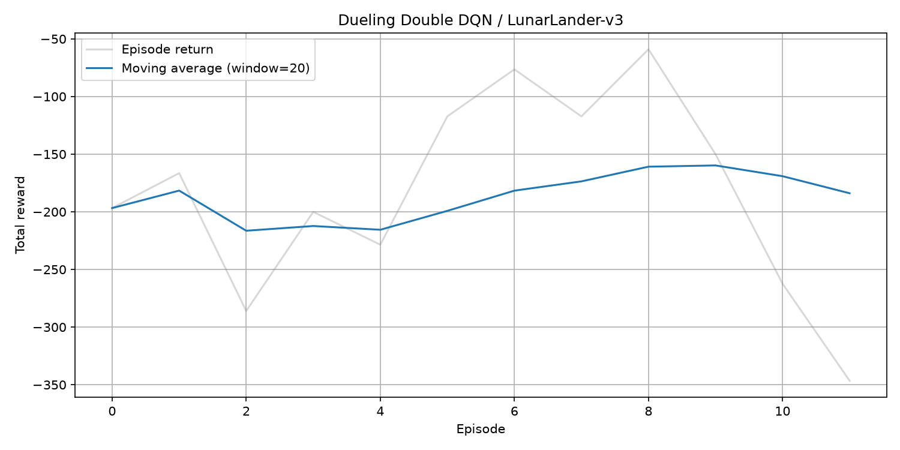

# 运行验证

日期：2026-11-18。执行者：Codex。环境：Python 3.11.15 / Darwin arm64 / CPU单线程。此次使用隔离venv并复用主机既有PyTorch等包，安装Gymnasium与Box2D依赖；不是全新机器安装验证。

## 指定测试

```bash
python -m unittest -v
```

4项通过：Dueling基线和动作差值；经验不足64条不更新、满64条更新且目标网不被梯度修改、硬同步；Double目标读取在线网选定动作而非目标网自身max；真正终止的转移不自举。

## 短程训练

```bash
python lunar_lander.py --episodes 12 --max-steps 200 --eval-episodes 3 --seed 42 --output-dir runs/smoke
```

实际12回合、1149个环境步、1086次梯度更新、1次目标网硬同步。前63条积累后未更新的计数与源码吻合。运行覆盖网络前反向、真实模拟环境交互、日志、绘图、权重保存及独立评估。

关闭探索、独立环境种子100042—100044的3局回报为：-331.79, -53.38, -56.37；均值 -147.18，总体标准差 130.54。每回合上限200步，为smoke run设置，与默认1000步不同。该结果仅验证流程，未达到200分，不能据此声称完成收敛、多种子性能评估或稳定着陆。

原始数据：[逐回合日志](smoke_training.csv)、[运行配置](smoke_config.json)、[训练与评估指标](smoke_metrics.json)。



## 权重重新加载

```bash
python lunar_lander.py --eval-only --checkpoint runs/smoke/model.pt --max-steps 200 --eval-episodes 3 --seed 42 --output-dir runs/reload
```

重新启动进程加载权重后，3局评估回报与训练结束后的独立评估逐项一致。未测试GUI的`--render`、CUDA/MPS或完整5000回合训练。大文件与运行目录不入库，曲线、配置和日志保存在本文旁。

## 主要依赖版本

```json
{
  "torch": "2.14.0",
  "gymnasium": "1.4.0",
  "numpy": "2.4.6",
  "matplotlib": "3.11.1",
  "Box2D": "2.3.10",
  "pygame-ce": "2.5.8"
}
```
